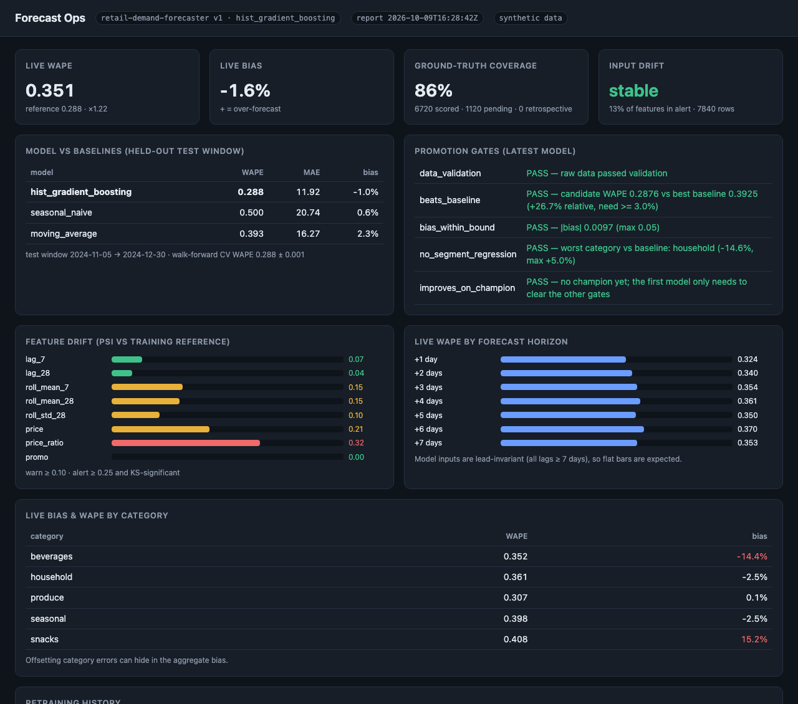
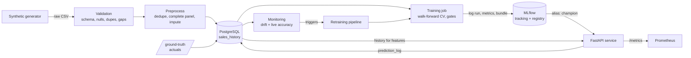
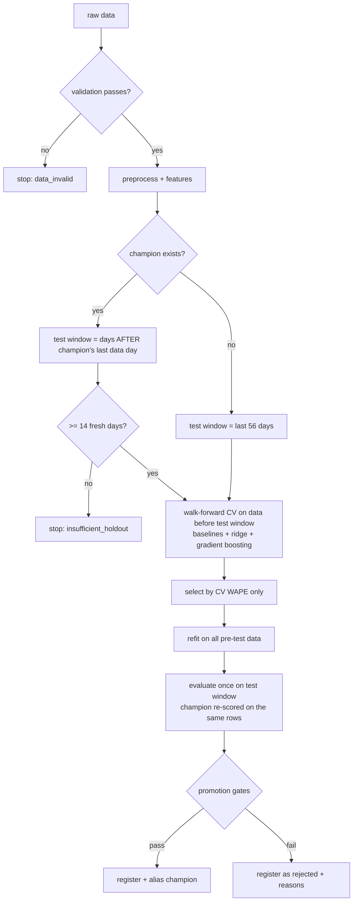

# Retail Demand Forecasting — an end-to-end MLOps platform

[](https://github.com/5exclamations/retail-mlops/actions/workflows/ci.yml)

A reproducible, CPU-only MLOps system around a store × SKU × day demand forecaster. It is built to show the parts of
ML engineering that sit *around* the model: leak-free features, honest evaluation, gated promotion, a versioned
registry, a prediction service, monitoring that uses ground truth, and retraining.

> **All data is synthetic** (`src/retail_mlops/data/generate.py`). Every accuracy number in this repository comes from
> that simulator, whose structure (weekday/yearly seasonality, promo lift, price elasticity) is exactly what the
> features are designed to capture. The numbers demonstrate that the *pipeline* measures things correctly; they say
> nothing about real retail demand.


<sub>The built-in `/dashboard`, captured from the local demo run described below (7 weeks of simulated drift after
training; v2 was trained and **rejected** by the gates).</sub>

## Business case
A retailer replenishes stock per store and SKU every few days. Under-forecasting causes lost sales; over-forecasting
causes waste and tied-up cash. The forecast must be (1) accurate against a naive "same as last week" rule, (2)
trustworthy enough to automate — so a worse model must never silently replace a better one — and (3) monitored,
because demand shifts (price inflation, a category taking off, a promo losing its pull). This repo is the machinery
that makes those three properties checkable.

## Architecture



* **One feature code path.** `features/engineering.py` is used by training, batch scoring and the API, so there is no
  train/serve skew; a test asserts that serving-time features equal training features.
* **The model decides how features are built.** Each registered version carries the config it was trained with; the
  API never re-derives features from the current repo config.
* **PostgreSQL** holds sales history (feature source *and* ground truth), the prediction log and retrain runs;
  **MLflow** holds runs, the model registry and artifacts.

### Training pipeline


### Inference pipeline
`POST /predict` → validate input (id patterns, date/price ranges, ≤ 1000 rows) → load the last 70 days of history from
SQL → append the requested rows (planned price/promo, unknown units) → build features with the model's own config →
predict (clipped ≥ 0) → log inputs/outputs/horizon to `prediction_log` → return. Requests more than 7 days beyond the
latest observed sales are refused (422) because the features would otherwise be undefined.

## Feature engineering (leak-free by construction)
Forecast contract: a row for date *t* may use calendar/price/promo of *t* (known in advance) and sales observed on or
before *t − 7*. Lags are 7/14/21/28 days, rolling mean 7/28 and std 28 are computed on the series shifted by the
horizon, plus promo flags at the lagged days, price relative to a lagged 28-day reference, weekday/month/yearly
sin-cos, and a holiday calendar. The config validator **rejects lags shorter than the horizon**, and tests poison
recent/future units and check each rolling feature does not move (and that the check is not vacuous).

## Model comparison (synthetic data, seed 42; reproduce with `make data train`)
Final test window = the last 56 days; selection used walk-forward CV only (3 folds × 28 days immediately before it).

| model | test WAPE | test MAE | test bias | walk-forward CV WAPE |
|---|---|---|---|---|
| seasonal naive (same weekday last week) | 0.500 | 20.74 | +0.6% | 0.480 |
| moving average (28d) | 0.393 | 16.27 | +2.3% | 0.372 |
| ridge (linear) | 0.332 | 13.77 | −0.1% | in run's `backtest.json` |
| **hist. gradient boosting (Poisson loss)** | **0.288** | **11.92** | −1.0% | **0.288 ± 0.001** |

WAPE = Σ|forecast − actual| / Σ actual. The best baseline is the moving average, so the boosted model improves WAPE by
26.7% relative to it. CV and test agree (0.288 vs 0.288), which is what one expects when nothing leaks. Training takes
about 40 s on a laptop CPU.

## Walk-forward evaluation
`models/backtest.py` fits on everything before each fold and scores the next 28 days (expanding window); folds sit
*before* the test window so the final test set is never used to choose a model. Backtest reports per-fold, pooled and
per-lead-day metrics. Because every input lag is ≥ 7 days, forecast lead does not change the model's inputs — the
per-lead numbers are a sanity check (0.277–0.297 across leads 1–7, i.e. no hidden lead dependence), not an accuracy-vs-
horizon curve. Genuine live horizon breakdowns come from monitoring (below).

## MLflow model lifecycle
* Every training call is one MLflow run (nested runs per model) logging config, data hash, git SHA, library versions,
  CV and test metrics, per-store/SKU/category breakdowns, gate results, the model and a `bundle/` (training config,
  metadata, drift reference).
* Registry: model `retail-demand-forecaster`; aliases `candidate`, `champion`, `previous`. Versions are **never
  deleted**; `python -m retail_mlops models` prints each version's stage, data hash, data end date, artifact hash,
  git SHA and rejection reasons. `rollback` re-points `champion` to `previous`.
* **Integrity:** models are serialised with **skops** (not pickle) with an explicit allow-list of reviewed types; a
  SHA-256 of the weights is stored as a registry tag and verified, together with the serialisation format, before
  anything is deserialised. A missing or mismatched hash refuses to load (tested).

## Retraining and promotion workflow
Triggers (`python -m retail_mlops retrain`): bootstrap (no champion), schedule (model age), new data volume, input
drift, live-performance degradation, or `--force`. A challenger is promoted only if **all** gates pass:

| gate | default |
|---|---|
| raw data validation | passes |
| beats best baseline | ≥ 3% relative WAPE reduction |
| aggregate bias | \|bias\| ≤ 5% |
| per-category regression vs baseline | ≤ 5% worse |
| fresh holdout | ≥ 14 days after the champion's last data day |
| **improves on champion** | **≥ 1% relative WAPE reduction on the same fresh rows** |
| **significant vs champion** | **95% paired block-bootstrap CI (resampling days) excludes 0** |

Why this design: a naive "candidate ≤ champion on the latest 56 days" check was wrong in two ways that a first version
of this repo had — the champion had often trained on part of that window, and ties were promoted. Now the holdout starts
after the champion's data ends (neither model has seen it), ties and insignificant gains are rejected, and every
rejection carries explicit reasons (`gates.json`, MLflow tag, registry tag, dashboard).

**Observed behaviour in the local demo** (7 simulated weeks after v1 was trained, with a category-level demand shift):
retraining fired on data volume; the challenger (trained on data before the fresh window) scored WAPE 0.3093 vs the
champion's 0.3088 on the 49 fresh days (−0.18%, 95% CI [−0.70%, +0.30%]) and was **rejected** on `improves_on_champion`
and `significant_vs_champion`. That is the intended outcome, and also shows the cost of the protocol: the challenger
cannot learn from the days used to judge it, so it only wins when the extra data helps by more than the noise floor.

## Monitoring and drift detection
Prometheus metrics (`/metrics`): request count/latency, inference latency, predictions per model version,
prediction-value histogram, error counters by type, per-feature PSI and alert flags, drift share, prediction PSI,
live WAPE/MAE/bias (overall and **by horizon and category**), ground-truth coverage, pending predictions, model info
and training time, retrain run counts and last-finished timestamps. Alert rules: `monitoring/alerts.yml` (latency,
server errors, drift, prediction shift, degraded accuracy, category bias, missing ground truth, failed retrains,
stale model, stalled monitoring, API down; syntax-checked with `promtool` in CI).

* **Input drift:** PSI against reference-quantile bins plus a KS test on logged model inputs; "alert" needs PSI ≥ 0.25
  *and* KS p < 0.001; overall drift needs ≥ 25% of monitored features in alert. Calendar features are excluded
  (they shift legitimately with the season).
* **Live accuracy only on matured, genuine forecasts:** a prediction is scored when its target date has complete
  actuals (≥ 95% of series) **and** its horizon was ≥ 1 day (a forecast for a day whose actual already existed is
  "retrospective" and never counted). Pending/retrospective counts are exported separately.
* **Demo result (not tuned):** after 7 drifted weeks, aggregate bias was only −1.6%, but per category it was
  −14% (beverages) and +15% (snacks) — offsetting errors that an aggregate monitor hides, hence the per-category
  gauges and alert. Live WAPE 0.351 was 1.22× the reference, just under the 1.25× degradation trigger; only
  `price_ratio` reached "alert", so overall drift stayed below its threshold. The thresholds are untuned defaults.

## API examples
```bash
curl -s -X POST localhost:8000/predict -H 'content-type: application/json' -d \
 '{"instances":[{"store_id":"S01","sku_id":"K001","date":"2025-02-18","promo":1,"price":2.9}]}'
# {"request_id":"72cc1bee882d4366","model_name":"retail-demand-forecaster","model_version":"1",
#  "predictions":[{"store_id":"S01","sku_id":"K001","date":"2025-02-18","prediction":70.068,
#                  "low_history":false,"horizon_days":1,"model_version":"1"}]}

curl -s localhost:8000/model            # version, algorithm, test + CV metrics, gates, artifact hash
curl -s localhost:8000/metrics          # Prometheus exposition
# admin endpoints are disabled unless ADMIN_API_KEY is set, then require X-API-Key:
curl -s -X POST localhost:8000/ground-truth -H "X-API-Key: $ADMIN_API_KEY" -H 'content-type: application/json' \
 -d '{"records":[{"store_id":"S01","sku_id":"K001","date":"2025-02-18","units":64}]}'
curl -s -X POST localhost:8000/monitoring/refresh -H "X-API-Key: $ADMIN_API_KEY"
```
Interactive docs at `/docs`; dashboard at `/dashboard`. Invalid ids/dates/prices, empty or >1000-row batches,
unknown series and dates beyond the horizon are rejected with 422.

## Quick start
Local (SQLite, no Docker; Python 3.12 + [uv](https://github.com/astral-sh/uv)):
```bash
make install
make test                 # unit + integration + API tests
make data train           # generate 8 stores x 20 SKUs x 730 days -> validate -> train -> gate -> register
python -m retail_mlops ingest --end 2024-12-30
python -m retail_mlops batch-predict --output data/out/forecast.csv
ADMIN_API_KEY=dev-key make serve            # http://localhost:8000/dashboard
make demo                 # simulated drift, monitoring, retraining (ADMIN_API_KEY not needed for the CLI)
```
Docker (Postgres + MLflow server + API + Prometheus; secrets from `.env`):
```bash
cp .env.example .env      # then change the values
docker compose up -d --build postgres mlflow
docker compose run --rm jobs python -m retail_mlops generate
docker compose run --rm jobs python -m retail_mlops ingest
docker compose run --rm jobs python -m retail_mlops train --source db
docker compose up -d api prometheus     # API :8000, MLflow :5000, Prometheus :9090 (localhost only)
```

## CI
GitHub Actions (`.github/workflows/ci.yml`): lint (ruff) · unit tests with coverage · data validation · full-dataset
training with `--require-promotion` · **reproducibility** (second training in a fresh store must give identical
metrics) · integration + API tests against a **PostgreSQL service** · Docker build · **Docker Compose end-to-end**
(train in containers, `/predict`, `/metrics`, retrain job, `promtool` rule check, and a check that Prometheus reports
the API target `up` and has scraped `retail_predictions_total`) · security (pip-audit, bandit, gitleaks).

## Technical trade-offs
* **Fresh-holdout protocol vs. freshest model.** Fair champion/challenger comparison forces the challenger to skip the
  newest ≥ 14 days. Alternatives: refit on everything after promotion (the served model then differs from the evaluated
  one) or shadow-deploy the challenger and compare online.
* **One model for all horizons ≤ 7 days** (lags ≥ 7) is simple and leak-free but throws away fresher signal for
  short leads; per-horizon models would be more accurate at lead 1 and cost 7× the training.
* **Gradient boosting with Poisson loss** fits non-negative counts but gives point forecasts only; no prediction
  intervals.
* **skops + hash** instead of pickle: safer and verifiable, but limited to allow-listed types and not byte-reproducible
  (archive metadata), so reproducibility is asserted on metrics/predictions.
* **SQL as feature store**: fine at this scale; a real deployment at millions of series would precompute features.
* **No Alembic migrations / auth beyond a shared admin key**: acceptable for a portfolio system, called out below.

## Limitations
* Synthetic data only; stock-outs are recorded as zero demand (censored demand is not modelled).
* Point forecasts; 7-day horizon; unknown series are rejected (no cold-start model).
* Planned prices default to the last known price and promos to none unless supplied.
* Drift reference mixes all seasons; thresholds (PSI 0.10/0.25, WAPE ratio 1.25) are defaults, not tuned.
* Per-lead backtest numbers are a sanity check, not a lead-time curve (inputs do not vary with lead).
* No DB migrations (schema changes need a fresh DB), single shared admin API key, no rate limiting or TLS (put a proxy
  in front), single API replica (multi-replica reload coordination not designed).

## Interview talking points
1. **Leakage** — why lags must be ≥ the horizon, how the test poisons future/recent values, and how train/serve parity is
   asserted rather than assumed.
2. **Honest model comparison** — the champion-saw-the-test-set flaw, how the fresh-holdout rule fixes it, and the
   trade-off it creates.
3. **Statistics in a gate** — paired block bootstrap over days (resampling dates keeps cross-series correlation) and why
   a 0.04% "improvement" must not promote.
4. **Monitoring that matches the business** — aggregate bias hid −14%/+15% category errors; matured-actuals-only scoring;
   retrospective forecasts excluded.
5. **Supply-chain safety** — skops allow-list, registry-held hash, default-deny admin endpoints, secrets via `.env`.
6. **What I would do next** — shadow deployment, per-horizon models, prediction intervals, Alembic, a real feature
   store, and tuning thresholds against real cost of error.

## Repository layout
```
src/retail_mlops/  data/ (generate, validate, preprocess) · features/ · models/ (estimators, backtest, train, metrics)
                   registry/ (gates, store, bundle, integrity) · serving/ (app, predictor, dashboard) ·
                   monitoring/ (drift, performance, metrics) · pipelines/ (batch_predict, retrain) · cli.py
tests/             data, features/leakage, backtest, gates, platform (train→promote/reject→rollback), API/security
monitoring/        prometheus.yml, alerts.yml        docs/DESIGN.md   deeper design notes
```
